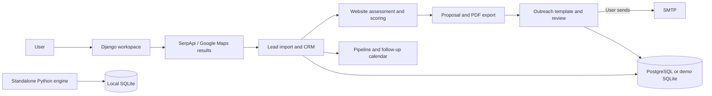

# ClientPilot AI

ClientPilot AI is a Django application for small agencies and consultants who need to turn local-business research into a manageable sales workflow. It brings discovery, qualification, website assessment, proposal preparation, and follow-up into one organization-scoped workspace.

## Implemented features

- Search Google Maps business listings through SerpApi, normalize results, and import selected prospects into the CRM.
- Manage leads, pipeline stages, follow-up tasks, and calendar views.
- Run rule-based website assessments covering SEO signals, HTTPS and redirects, and technology indicators. Generate recommendations and estimated effort or pricing from configured rules.
- Generate proposals from audit findings and export them as PDFs.
- Create template-based outreach from proposals, send individual emails through SMTP on user action, and track outreach status and events.
- Use a separate Python engine for opportunity workflows, scoring, local SQLite persistence, and proposal and outreach packages.

## Architecture

The web application uses Python, Django 6, server-rendered templates, Django ORM, and PostgreSQL or SQLite for the loopback demo. HTTP and HTML processing use Requests and Beautiful Soup. PDF export uses xhtml2pdf. The sibling `engine/` contains Python services and standalone tools with their own SQLite storage. The draft API adapter for that engine is disabled in the web URL configuration.



## AI, APIs, and automation

**Implemented.** SerpApi supplies Google Maps discovery results. The site assessment fetches web pages over HTTP(S), and SMTP handles user-initiated email delivery. Scoring, recommendations, proposal assembly, and draft generation use deterministic rules and templates.

**Planned or scaffolded.** The engine contains LLM configuration and an outreach extension point for future model integration. LinkedIn discovery and the direct Google Search connector are stubs. The Django REST API routes are disabled. The standalone engine dependencies can be installed separately with `python -m pip install -r engine/requirements.txt`. Follow-up assets and tasks support a human-operated workflow. Scheduled campaigns and automatic multichannel delivery are outside the implemented workflow.

## Run the SQLite demo

Use Python 3.12 or later. This mode needs no PostgreSQL server, SerpApi key, or SMTP credentials.

```powershell
python -m venv .venv
.\.venv\Scripts\python.exe -m pip install -r backend/requirements.txt
Set-Location backend
..\.venv\Scripts\python.exe manage.py migrate --settings=config.showcase_settings
..\.venv\Scripts\python.exe manage.py runserver 127.0.0.1:8000 --noreload --settings=config.showcase_settings
```

On macOS/Linux, use `.venv/bin/python` from the root and `../.venv/bin/python` from `backend/`. Open `http://127.0.0.1:8000/` and register with a fictional organization and an example email. In a second shell from `backend/`, run `..\.venv\Scripts\python.exe manage.py seed_demo --username <your-local-username> --settings=config.showcase_settings`. The ignored SQLite file persists between runs. Each server process generates a signing key, so sign in again after restarting. Discovery uses fictional results and email stays in process memory. Website assessments still require a public website you control. The offline test suite exercises that step with a synthetic response.

## Run with PostgreSQL

Use Python 3.12 or later and a local PostgreSQL instance. Create a dedicated database owned by a development role. From an administrative psql session, run:

```sql
CREATE ROLE clientpilot_local LOGIN;
\password clientpilot_local
CREATE DATABASE clientpilot_local OWNER clientpilot_local;
```

```bash
python -m venv .venv
# PowerShell: .venv\Scripts\Activate.ps1
# macOS/Linux: source .venv/bin/activate
python -m pip install -r backend/requirements.txt
cp .env.example backend/.env
```

In PowerShell, use `Copy-Item .env.example backend/.env` for the last command. Replace placeholders in `backend/.env`, set `DEBUG=True` for loopback development, and set `ALLOWED_HOSTS=localhost,127.0.0.1`. Set `DB_NAME=clientpilot_local`, `DB_USER=clientpilot_local` and enter the password you set above. Generate a fresh `SECRET_KEY` for this environment. On Windows, copy one directly to the clipboard with `python -c "import secrets; print(secrets.token_hex(32))" | Set-Clipboard`. Paste it into the ignored local file and then clear the clipboard.

```bash
cd backend
python manage.py migrate
python manage.py check
python manage.py runserver 127.0.0.1:8000
```

Open `http://127.0.0.1:8000/` and register with a fictional organization and reserved email such as `reviewer@example.invalid`. Then run `python manage.py seed_demo --username <your-local-username>` from `backend/` to create one fictional CRM lead and follow-up task. The web application has a separate optional SerpApi credential for live discovery. Configure SMTP only if intentionally testing delivery. Use a local mail catcher or dedicated test mailbox.

| Variables | Purpose |
| --- | --- |
| `SECRET_KEY` | Unique Django signing key |
| `DEBUG`, `ALLOWED_HOSTS`, `CSRF_TRUSTED_ORIGINS`, `TRUST_PROXY_SSL_HEADER` | Runtime and HTTP security settings |
| `DB_NAME`, `DB_USER`, `DB_PASSWORD`, `DB_HOST`, `DB_PORT` | PostgreSQL connection |
| `SERPAPI_API_KEY` | Optional live business discovery |
| `EMAIL_HOST`, `EMAIL_PORT`, `EMAIL_USE_SSL`, `EMAIL_USE_TLS`, `EMAIL_HOST_USER`, `EMAIL_HOST_PASSWORD`, `DEFAULT_FROM_EMAIL` | Optional test SMTP. Use one transport mode appropriate to your provider. |

## Verification

From `backend/`, run `python manage.py test ../tests --settings=config.test_settings` for the offline suite. It covers URL policy, authorization, CSRF, discovery import, proposal PDF generation, in-memory mail, and the demo seed. To test with PostgreSQL, grant the local role permission to create a disposable test database and run `python manage.py test ../tests` with your local database settings.

## Demo walkthrough

Open the seeded lead or add a fictional lead manually, change its CRM status, and add a follow-up task. Run a discovery search without a SerpApi key to see synthetic results. The fictional lead has a reserved hostname. To exercise a live assessment, use a publicly reachable website you control. The offline suite supplies a synthetic website response for the audit-to-proposal workflow. Open the audit, generate a proposal, download its PDF, and review the outreach draft. Screenshots for a portfolio should show synthetic data only.

## Security and limitations

Use this as a local portfolio demo. The website assessment permits only public HTTP(S) destinations on standard ports. It checks all DNS answers and each redirect, connects to a checked address, verifies TLS, and limits response size. Deploy with infrastructure egress controls, request rate limits, and monitoring before allowing untrusted public use. Keep production credentials and private artifacts out of Git. Generated estimates are rule-based, and live discovery and mail depend on third-party configuration. Bind development servers to loopback. Production mode enables HTTPS redirects and secure cookies. Set `TRUST_PROXY_SSL_HEADER=True` only behind a trusted proxy that strips and sets the forwarded scheme header. Run `python manage.py collectstatic` for production static files. See [Architecture](docs/ARCHITECTURE.md).

## Developer contributions

- Built the Django workflow from normalized prospect discovery through CRM, assessment, proposal export, and outreach tracking.
- Implemented rule-based scoring and recommendation services and structured outreach and proposal generation.
- Separated web application persistence from standalone engine tools and data.

The showcase uses a curated [source allowlist](docs/FILE_ALLOWLIST.txt) and ships with fictional demo data.
