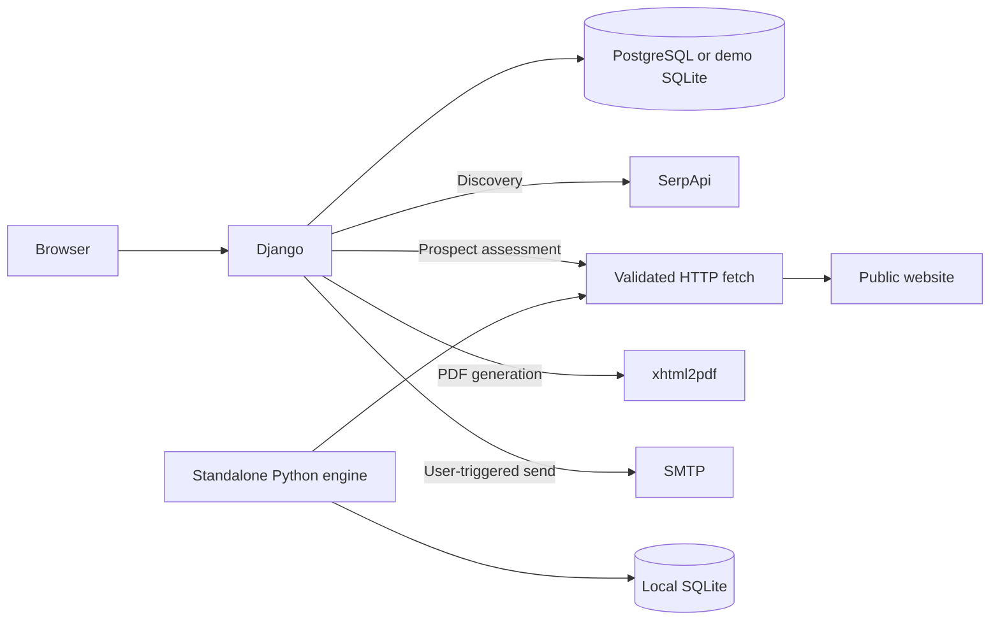

# Architecture

The Django 6 web app renders templates and stores accounts, organizations, leads, audit records, proposals, tasks, and outreach in PostgreSQL. The loopback demo uses the same ORM and migrations with a separate local SQLite database, synthetic discovery, and in-memory email. A discovery provider normalizes SerpApi Google Maps results for import. A prospect website assessment records HTML and HTTPS signals and calculates recommendations with deterministic rules. Proposals use those findings, xhtml2pdf renders downloadable PDFs, and a user can send an outreach draft through SMTP.

## Boundaries

- CRM actions require authentication, tenant-scoped object lookups, POST and Django CSRF checks. Discovery searches that call the provider or update import state also use POST.
- Prospect requests use a shared HTTP transport that vets every DNS answer, dials a vetted address directly, retains TLS hostname verification, validates every redirect, blocks HTTPS downgrades, and limits redirects and response size. The transport bypasses ambient proxies. Use separate infrastructure egress controls and limit outbound DNS and HTTP access before hosting for untrusted users.
- Engine modules have their own SQLite repositories and optional dependencies. The draft REST adapter remains disabled. The email workflow requires user initiation. LLM generation, LinkedIn discovery and autonomous agents are unimplemented.
- Reserved synthetic domains are deliberately unreachable. Integration tests mock external responses and use in-memory mail.
